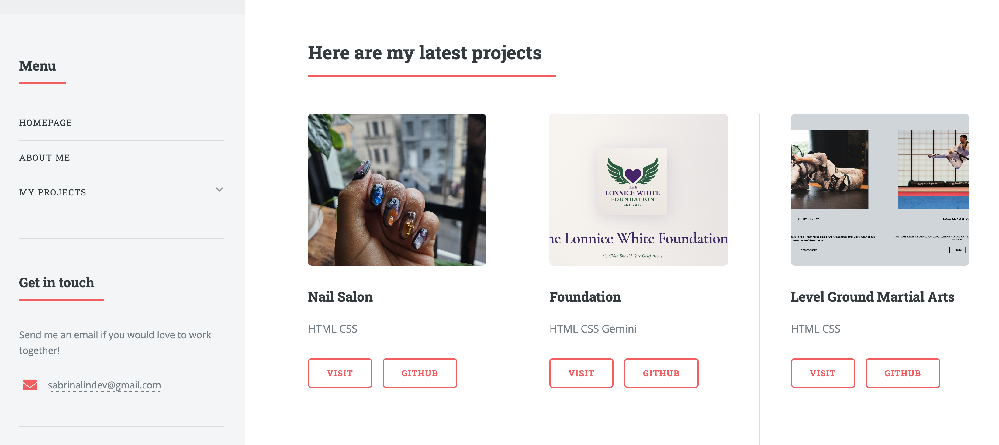

# 👩‍💻 Sabrina Lin | Portfolio

My personal portfolio website, where I share who I am, the projects I've built, and how to get in touch.

## Demo

Live: [site](https://sabrinalindev.netlify.app/)



## About the Project

This site showcases my work as a web developer. It is built on the free [Editorial](https://html5up.net/editorial) template by HTML5 UP, which I customized with my own content, projects, and images.


## Features

- Toggleable sidebar with an accordion-style menu
- Responsive layout for desktop, tablet, and mobile
- Project cards linking to live demos and GitHub repos


## Built With

- HTML5
- CSS3
- JavaScript and jQuery (included with the template)
- [Editorial](https://html5up.net/editorial) template by HTML5 UP

## Getting Started

1. Clone the repo
   ```bash
   git clone https://github.com/sabrinalindev/Portfolio_Sabrina.git
   cd Portfolio_Sabrina
   ```
2. Open `index.html` in your browser

No build step or dependencies are required.

## Project Structure

```
Portfolio_Sabrina/
├── index.html       # Home page
├── about-me.html    # About page
├── elements.html    # Template elements reference
├── assets/          # CSS, JavaScript, fonts
├── images/          # Photos and images
└── LICENSE.txt
```

## What I Learned

- How to customize an existing template with my own content and styling
- How to read and modify HTML, CSS, and JavaScript written by someone else
- How to organize and present my projects for employers
- 【你自己的心得】

## Credits

- Template: [Editorial](https://html5up.net/editorial) by [HTML5 UP](https://html5up.net) (@ajlkn), licensed under [CCA 3.0](https://html5up.net/license)
- Demo images: [Unsplash](https://unsplash.com) 
- Icons: [Font Awesome](https://fontawesome.com)
- Other: [jQuery](https://jquery.com), [Responsive Tools](https://github.com/ajlkn/responsive-tools)

## License

The template is distributed under the Creative Commons Attribution 3.0 License. See `LICENSE.txt` for details. My own content, text, and photos are © Sabrina Lin.